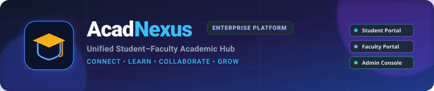
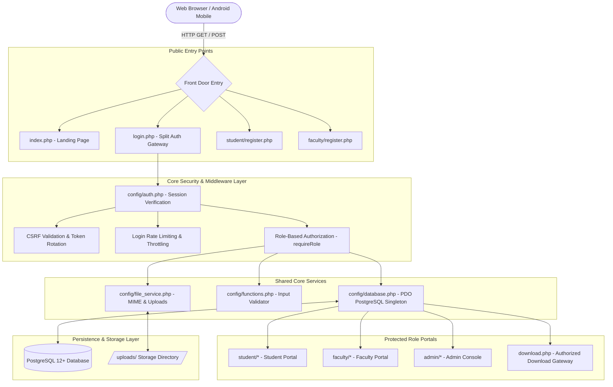
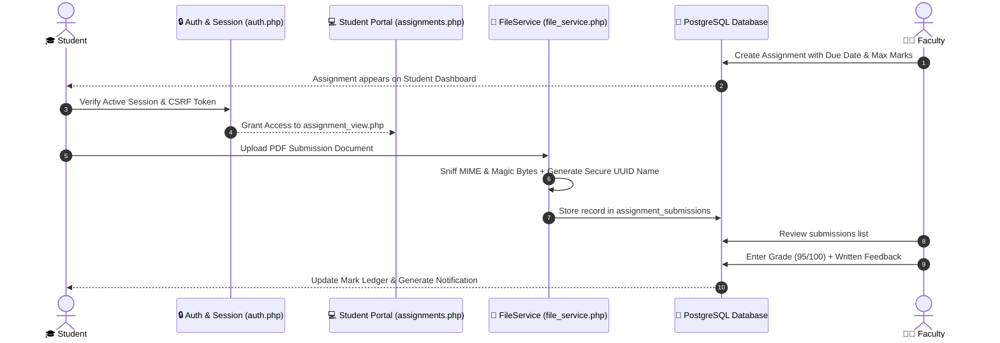
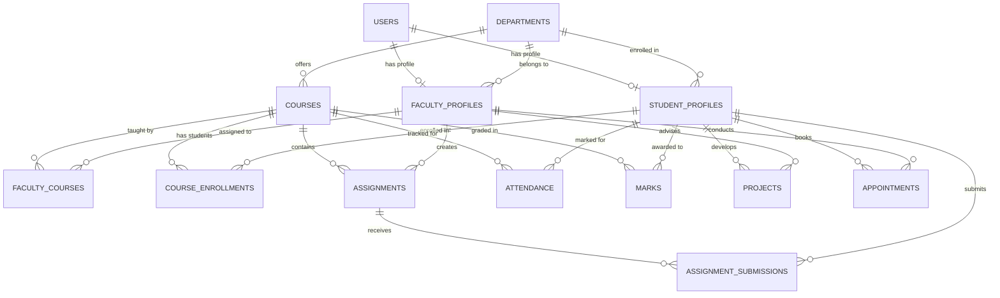

# AcadNexus — Unified Student–Faculty Academic Hub

<div align="center">



<br/><br/>

[](#technology-stack)
[](#technology-stack)
[](#security-practices)
[](#technology-stack)
[](#technology-stack)
[](#ui-and-design-system)
[](#security-practices)

<p align="center">
  <b>A real-world, production-architected academic workspace uniting Students, Faculty, and Administrators.</b><br/>
  Engineered with pure native PHP 8+, PostgreSQL relational persistence, strict role-based access controls, and touch-optimized mobile responsiveness.
</p>

<p align="center">
  <a href="#quick-navigation">Explore Docs</a> •
  <a href="#platform-modules-and-features">Platform Modules</a> •
  <a href="#application-architecture">System Architecture</a> •
  <a href="#installation-and-setup">Quickstart Guide</a> •
  <a href="#demo-accounts">Demo Accounts</a> •
  <a href="#security-practices">Security Model</a>
</p>

</div>

---

## 📖 Project Overview

Higher education institutions often struggle with fragmented academic tooling: attendance is taken in isolated spreadsheets, assignments are exchanged via insecure email threads, lecture documents reside on disparate cloud drives, and student project supervision lacks transparent milestone tracking.

**AcadNexus** resolves these bottlenecks by offering a centralized, enterprise-grade academic platform built from the ground up to unify daily institutional interactions into a single, cohesive interface.

```
       ┌────────────────────────────────────────────────────────┐
       │             ACADNEXUS ACADEMIC ECOSYSTEM               │
       └──────────────────────────┬─────────────────────────────┘
                                  │
         ┌────────────────────────┼────────────────────────┐
         ▼                        ▼                        ▼
  🎓 STUDENTS               👨‍🏫 FACULTY             🛡️ ADMINISTRATORS
  Course Catalogue          Course Rosters          Institutional Oversight
  Assignment Submissions    Assignment Grading      Department & Course CRUD
  Attendance Tracking       Attendance Marking      User Lifecycle & Audit
  Results & GPA Sheet       Exam Marks Ledger       Performance Reports
  Project Mentorship        Project Supervision     System Security
  Faculty Appointments      Schedule Management     Campus Broadcasts
```

### Key Problems Solved
- **Workflow Fragmentation:** Replaces 5+ disparate standalone utilities with one unified application engine.
- **Attendance Transparency:** Real-time percentage tracking with automated shortage alerts (< 75%) warning students before examination eligibility issues arise.
- **Grading & Assessment Integrity:** Strict database check constraints bounding grades (0–100) and preventing unauthorized mark manipulation.
- **Document Security & Access Isolation:** File uploads protected with two-stage MIME/magic-byte sniffing, cryptographic file storage names, and course-enrollment authorization gates.
- **Mobile-First Classroom Ergonomics:** 100% responsive interfaces formatted for Android and iOS mobile web browsers, featuring bottom-dock navigation and card-first data feeds.

---

## 🧭 Quick Navigation

- [Project Overview](#-project-overview)
- [Quick Navigation](#-quick-navigation)
- [Platform Modules and Features](#-platform-modules-and-features)
  - [1. Student Portal](#1-student-portal)
  - [2. Faculty Portal](#2-faculty-portal)
  - [3. Administrator Console](#3-administrator-console)
- [Feature Highlights Matrix](#-feature-highlights-matrix)
- [Application Architecture](#-application-architecture)
  - [System Context & Request Lifecycle](#system-context--request-lifecycle)
  - [End-to-End Workflow Diagram](#end-to-end-workflow-diagram)
- [Technology Stack](#-technology-stack)
- [Project Directory Structure](#-project-directory-structure)
- [Prerequisites](#-prerequisites)
- [Installation and Setup](#-installation-and-setup)
- [Environment and Configuration](#-environment-and-configuration)
- [Demo Accounts](#-demo-accounts)
- [Database Schema & Entity Model](#-database-schema--entity-model)
- [Security Practices & Hardening](#-security-practices--hardening)
- [UI and Design System](#-ui-and-design-system)
- [Application Workflows](#-application-workflows)
- [Troubleshooting Guide](#-troubleshooting-guide)
- [Testing & Quality Verification](#-testing--quality-verification)
- [Roadmap & Future Enhancements](#-roadmap--future-enhancements)
- [Contributing Guidelines](#-contributing-guidelines)
- [License and Attribution](#-license-and-attribution)

---

## 🏛️ Platform Modules and Features

AcadNexus is divided into three role-restricted portals, each tailored to specific academic responsibilities.

### 1. Student Portal

Located under [`student/`](student/), providing students with a 360-degree view of their academic journey.

| Feature Page | Implementation File | Workflow & Capability |
| :--- | :--- | :--- |
| **Academic Dashboard** | [`student/dashboard.php`](student/dashboard.php) | Live GPA score, attendance summary gauge, 4 dynamic KPI metrics, interactive Chart.js subject analytics, and instant action shortcuts. |
| **Upcoming Tasks Feed** | [`student/dashboard.php`](student/dashboard.php) | Mobile-adaptive dual view: full data table on desktop and card feed on phones showing assignment titles, due dates, and grading status. |
| **Course Catalogue** | [`student/courses.php`](student/courses.php) | Enrolled course overviews, assigned faculty contact cards, and 1-tap automated department course auto-enrollment. |
| **Assignment Hub** | [`student/assignments.php`](student/assignments.php) | Filter tasks by All, Pending, Submitted, and Graded; search assignments in real time; track deadlines. |
| **Submission Gateway** | [`student/assignment_view.php`](student/assignment_view.php) | Read faculty specifications, download attachments, drag-and-drop submit work (PDF/DOCX/ZIP), and view grading feedback. |
| **Attendance Tracker** | [`student/attendance.php`](student/attendance.php) | Course-wise attendance percentages, present/absent history logs, and automatic alert warnings when falling below 75%. |
| **Semester Ledger** | [`student/results.php`](student/results.php) | Detailed mark transcripts across Internals, Assignments, Quizzes, Midterms, Final Exam, and letter grades with a print-ready grade sheet. |
| **Course Materials** | [`student/materials.php`](student/materials.php) | Download study guides, lecture slides, and syllabus files uploaded by department professors. |
| **Faculty Directory** | [`student/faculty.php`](student/faculty.php) | Search professors by department, view research specializations, office room locations, and initiate consultations. |
| **Appointment Booking** | [`student/appointments.php`](student/appointments.php) | Request 1-on-1 meetings, select date/time slots, write meeting agendas, and monitor confirmation status. |
| **Capstone Mentorship** | [`student/projects.php`](student/projects.php) | Submit project proposals, assign faculty advisors, manage development milestones, and track completion progress. |
| **Digital ID Card** | [`student/profile.php`](student/profile.php) | Digital lanyard student pass with scannable QR verification, avatar photo uploads, and editable contact details. |
| **System Notifications**| [`student/notifications.php`](student/notifications.php) | Audit trail of grades posted, appointment updates, announcements, and direct navigation links. |

---

### 2. Faculty Portal

Located under [`faculty/`](faculty/), equipping professors with tools for course delivery and academic administration.

| Feature Page | Implementation File | Workflow & Capability |
| :--- | :--- | :--- |
| **Faculty Dashboard** | [`faculty/dashboard.php`](faculty/dashboard.php) | Teaching load statistics, total enrolled students, pending assignment evaluations, and class performance charts. |
| **Course Roster** | [`faculty/courses.php`](faculty/courses.php), [`faculty/students.php`](faculty/students.php) | View allocated teaching courses, inspect enrolled student rosters, search students, and view contact profiles. |
| **Assignment Creator** | [`faculty/assignment_create.php`](faculty/assignment_create.php) | Publish assignments with title, description, max marks, submission deadlines, and downloadable reference attachments. |
| **Grading Panel** | [`faculty/assignment_submissions.php`](faculty/assignment_submissions.php) | Inspect student responses, download submitted files, score submissions, and provide qualitative feedback. |
| **Course Materials** | [`faculty/materials.php`](faculty/materials.php) | Upload PDF lecture notes, code archives, slides, and learning documents with validation. |
| **Daily Attendance** | [`faculty/attendance.php`](faculty/attendance.php) | Record daily class attendance (Present/Absent) with PostgreSQL `UPSERT` operations preventing duplicate records. |
| **Examination Marks** | [`faculty/marks.php`](faculty/marks.php) | Enter internal (20), assignment (25), quiz (10), mid (30), and final exam marks with automated totals and letter grade calculation. |
| **Office Consultations**| [`faculty/appointments.php`](faculty/appointments.php) | Review student meeting requests, approve or decline slots, and provide scheduling notes. |
| **Project Guidance** | [`faculty/projects.php`](faculty/projects.php) | Supervise student capstone projects, review proposals, update milestone completion percentages, and post notes. |
| **Bulletins Publisher** | [`faculty/announcements.php`](faculty/announcements.php) | Broadcast course notices with priority badges (`Normal`, `Important`, `Urgent`) and expiration dates. |
| **Faculty Profile** | [`faculty/profile.php`](faculty/profile.php) | Manage designations, office room numbers, qualifications, and profile credentials. |

---

### 3. Administrator Console

Located under [`admin/`](admin/), granting administrators institutional control, security logs, and compliance reporting.

| Feature Page | Implementation File | Workflow & Capability |
| :--- | :--- | :--- |
| **Executive Console** | [`admin/dashboard.php`](admin/dashboard.php) | Institutional metrics (departments, faculty, students, courses) and real-time security activity audit feed. |
| **User Management** | [`admin/users.php`](admin/users.php) | Manage user accounts; activate, deactivate, or suspend access with immediate session termination. |
| **Student Directory** | [`admin/students.php`](admin/students.php) | Searchable database of all enrolled students, department assignments, and academic standing. |
| **Faculty Directory** | [`admin/faculty.php`](admin/faculty.php) | Complete faculty database management with department linkages, qualifications, and teaching roles. |
| **Departments CRUD** | [`admin/departments.php`](admin/departments.php) | Create, edit, and maintain academic departments with unique codes and program descriptions. |
| **Course Catalogue** | [`admin/courses.php`](admin/courses.php) | Add new courses, set credit limits, assign semester levels, and bind courses to departments. |
| **Institutional Reports**| [`admin/reports.php`](admin/reports.php) | Automated attendance shortage report (< 75%) and top academic achievers report by semester/department. |
| **Global Bulletins** | [`admin/announcements.php`](admin/announcements.php) | Publish university-wide announcements visible across all student and faculty portals. |

---

## ⚡ Feature Highlights Matrix

```
┌─────────────────────────────────────────────────────────────────────────────────┐
│                      ACADNEXUS CORE CAPABILITY MATRIX                           │
├───────────────────────┬───────────────┬────────────────┬────────────────────────┤
│ Capability            │ Student       │ Faculty        │ Administrator          │
├───────────────────────┼───────────────┼────────────────┼────────────────────────┤
│ Course Enrollment     │ Self/Auto     │ Assigned View  │ Master Management      │
│ Attendance Records    │ View Logs     │ Mark / Update  │ Institutional Reports  │
│ Assignments           │ Submit Files  │ Create & Grade │ System Monitoring      │
│ Examination Marks     │ Transcript    │ Enter & Compute│ Audit Roster           │
│ Capstone Projects     │ Propose Tasks │ Guide & Review │ Department Overview    │
│ Consultations         │ Book Meetings │ Accept/Decline │ Activity Logs          │
│ Course Materials      │ Download      │ Upload Files   │ Storage Oversight      │
│ Security Audit        │ Profile Guard │ Profile Guard  │ Full User Management   │
└───────────────────────┴───────────────┴────────────────┴────────────────────────┘
```

---

## 🏗️ Application Architecture

AcadNexus follows a lightweight, high-performance MVC-style architecture implemented in native PHP 8+. Every incoming HTTP request flows through centralized security, database, and authentication guards before dispatching to role-isolated handlers.

### System Context & Request Lifecycle



### End-to-End Workflow Diagram



---

## 💻 Technology Stack

AcadNexus intentionally uses a lean, dependency-free architecture without bloated framework overhead.

| Layer | Technology | Version | Purpose in AcadNexus |
| :--- | :--- | :--- | :--- |
| **Backend Engine** | [PHP](https://www.php.net/) | `8.0+` *(Tested on 8.5)* | Native procedural and object-oriented backend application logic, session management, and routing. |
| **Database** | [PostgreSQL](https://www.postgresql.org/) | `12+` *(Tested on 18)* | Relational database engine supporting check constraints, composite keys, indexes, and UPSERT syntax. |
| **Database Driver**| [PDO PostgreSQL](https://www.php.net/manual/en/ref.pdo-pgsql.php) | `Extension` | Prepared statement query execution, strict type parameter bindings, and transaction isolation. |
| **Frontend Layout**| [HTML5](https://developer.mozilla.org/en-US/docs/Web/HTML) | Standard | Semantic, accessible page structures with viewport containment and safe area tags. |
| **Styling** | [Vanilla CSS3](https://developer.mozilla.org/en-US/docs/Web/CSS) | Standard | Modular styling, responsive grid/flexbox layouts, CSS custom properties, and dark glassmorphism effects. |
| **Client Scripts** | [JavaScript](https://developer.mozilla.org/en-US/docs/Web/JavaScript) | ES6+ | Client-side tab switching, instant search filtering, password reveal toggles, and modal dialogs. |
| **Visual Charts** | [Chart.js](https://www.chartjs.org/) | `v4.x CDN` | Interactive analytics rendering attendance donut ratios, grade distributions, and performance graphs. |

---

## 📁 Project Directory Structure

```
AcadNexus/
├── .env.example                       # Template for environment configuration
├── .htaccess                          # Apache directory protection and security headers
├── .user.ini                          # PHP upload size and memory directives
├── BACKUP_AND_RECOVERY.md             # Database backup and disaster recovery guide
├── README.md                          # Project documentation
├── SECURITY_AUDIT_REPORT.md           # Security audit report and verification log
├── database.sql                       # Complete PostgreSQL schema, constraints, and seed data
├── download.php                       # Secure, authenticated file download gateway
├── import_db.php                      # CLI database schema importer
├── index.php                          # Landing page and campus introduction
├── login.php                          # Authentication gateway with demo credentials
├── logout.php                         # Session destruction and cleanup handler
├── setup_db.php                       # CLI database creation utility
│
├── admin/                             # 🛡️ Administrator Management Console
│   ├── announcements.php              # Global campus bulletin broadcaster
│   ├── courses.php                    # Course catalogue CRUD
│   ├── dashboard.php                  # System metrics and activity audit log
│   ├── departments.php                # Academic departments CRUD
│   ├── faculty.php                    # Faculty database records
│   ├── projects.php                   # Department project oversight
│   ├── reports.php                    # Shortage and academic excellence reports
│   ├── settings.php                   # Administrator credentials and settings
│   ├── students.php                   # Student database records
│   └── users.php                      # User account status manager
│
├── config/                            # ⚙️ Core Configuration & Services
│   ├── auth.php                       # RBAC checks, session guard, CSRF engine, throttling
│   ├── database.php                   # PDO PostgreSQL singleton connection
│   ├── file_service.php               # Secure file upload, MIME sniffing, validation
│   └── functions.php                  # Input validator, flash toast notifications, audit logging
│
├── database/                          # 🐘 Database Migrations & Versioning
│   ├── migrate.php                    # Migration runner utility
│   └── migrations/                    # SQL migration revisions (001, 002, 003)
│
├── docs/                              # 📚 Documentation Resources
│   └── images/                        # Architecture graphics and SVG branding
│
├── faculty/                           # 👨‍🏫 Faculty Portal
│   ├── announcements.php              # Course bulletins publisher
│   ├── appointments.php               # Student consultation manager
│   ├── assignment_create.php          # Assignment creation form with attachments
│   ├── assignment_submissions.php     # Submission review and grading panel
│   ├── assignments.php                # Assignment index
│   ├── attendance.php                 # Daily class attendance marking (UPSERT)
│   ├── courses.php                    # Allocated teaching courses
│   ├── dashboard.php                  # Faculty dashboard and class analytics
│   ├── marks.php                      # Exam marks entry and grade calculator
│   ├── materials.php                  # Study materials upload manager
│   ├── notifications.php              # Faculty alerts log
│   ├── profile.php                    # Faculty profile details
│   ├── projects.php                   # Capstone mentorship manager
│   ├── register.php                   # Faculty registration page
│   ├── settings.php                   # Security and password settings
│   └── students.php                   # Enrolled student rosters
│
├── includes/                          # 🧩 Shared Layout & UI Components
│   ├── footer.php                     # Mobile bottom navigation bar and scripts
│   ├── header.php                     # Responsive sidebar drawer and topbar
│   └── toast.php                      # Dynamic toast notification component
│
├── student/                           # 🎓 Student Portal
│   ├── announcements.php              # View campus bulletins and alerts
│   ├── appointments.php               # Book 1-on-1 faculty consultations
│   ├── assignment_view.php            # Submit assignments and view feedback
│   ├── assignments.php                # Filterable assignment task list
│   ├── attendance.php                 # Course attendance percentages and warning
│   ├── courses.php                    # Enrolled courses and auto-enrollment
│   ├── dashboard.php                  # Main dashboard, KPI cards, and charts
│   ├── faculty.php                    # Searchable faculty directory
│   ├── materials.php                  # Course lecture notes and slide downloads
│   ├── notifications.php              # Student notification history
│   ├── profile.php                    # Student digital lanyard pass and bio
│   ├── projects.php                   # Capstone project proposal and milestones
│   ├── register.php                   # Student account registration
│   ├── results.php                    # Semester marks transcript and grade sheet
│   └── settings.php                   # Account password management
│
├── tests/                             # 🧪 Automated Test Suite
│   └── run_tests.php                  # 19-scenario unit and workflow test suite
│
└── uploads/                           # 📂 Secure Upload Storage
    ├── .htaccess                      # Execution disabled (`php_flag engine off`)
    ├── admin/                         # Admin document uploads
    ├── announcement/                  # Circular images and notices
    ├── faculty/                       # Course lecture materials and attachments
    └── student/                       # Assignment submissions and avatar images
```

---

## 📋 Prerequisites

Ensure your environment satisfies the following requirements:

1. **PHP:** Version `8.0` or higher (verified on PHP 8.2, 8.4, and 8.5).
2. **PostgreSQL:** Version `12.0` or higher running on port `5432`.
3. **PHP Extensions:**
   - `pdo_pgsql` — Database driver for PostgreSQL connectivity.
   - `fileinfo` — MIME type detection (built-in binary fallback included in `FileService`).
   - `session` — Secure user authentication state tracking.
   - `json` — JSON payload serialization for Chart.js analytics.
4. **Web Browser:** Modern browser supporting ES6 JavaScript and HTML5.

### Check Environment via Terminal

```bash
# Check PHP version
php -v

# Verify required PostgreSQL PDO extension is loaded
php -m | grep -i pdo_pgsql
```

---

## 🚀 Installation and Setup

Follow these steps to set up AcadNexus locally:

### Step 1: Open the Project Directory
Navigate into the workspace root:
```bash
cd AcadNexus
```

### Step 2: Configure PostgreSQL Database
Ensure your PostgreSQL server is active. The application connects to a database named `acadnexus`.

You can configure credentials using either an `.env` file or directly in `config/database.php`:

```bash
# Copy sample environment configuration
cp .env.example .env
```

Adjust the database credentials in `.env` or `config/database.php`:
```php
define('DB_HOST', 'localhost');
define('DB_PORT', '5432');
define('DB_NAME', 'acadnexus');
define('DB_USER', 'your_postgres_username');
define('DB_PASS', 'your_postgres_password');
```

### Step 3: Initialize Database Schema & Seed Data
Execute the setup and import scripts using the PHP CLI:

```bash
# 1. Create the acadnexus database if it does not exist
php setup_db.php

# 2. Import database.sql (tables, indexes, check constraints, and seed data)
php import_db.php
```

*Alternative manual import using `psql`:*
```bash
psql -U your_postgres_username -d acadnexus -f database.sql
```

### Step 4: Verify Upload Directory Permissions
Ensure that the `uploads/` folder is writable by the PHP process:
```bash
# Linux/macOS permissions (if applicable)
chmod -R 775 uploads/
```

### Step 5: Start the Local Development Server
Launch PHP's built-in web server from the project root:

```bash
php -S localhost:8000
```

### Step 6: Access the Application
Open your web browser and navigate to:
```
http://localhost:8000
```
The application will launch directly into the **AcadNexus Landing Page** (`index.php`).

---

## 🔑 Demo Accounts

The database comes pre-seeded with realistic academic accounts across all three user roles.

> [!WARNING]  
> Demo accounts use the default password **`Password123`**. These credentials are for local development and demonstration only. Never reuse demo credentials in a production environment.

| Role | Username | Email Address | Default Password | Initial Dashboard |
| :--- | :--- | :--- | :--- | :--- |
| 🎓 **Student** | `alex_rivera` | `student@acadnexus.test` | `Password123` | [`student/dashboard.php`](student/dashboard.php) |
| 👨‍🏫 **Faculty** | `dr_alan` | `faculty@acadnexus.test` | `Password123` | [`faculty/dashboard.php`](faculty/dashboard.php) |
| 🛡️ **Administrator** | `admin` | `admin@acadnexus.test` | `Password123` | [`admin/dashboard.php`](admin/dashboard.php) |

*Additional seeded student accounts:* `emily_w`, `mbrown`, `sdavis`, `dkim`  
*Additional seeded faculty accounts:* `prof_sarah` (Software Eng), `dr_robert` (Networks)

---

## 🗄️ Database Schema & Entity Model

The relational schema is defined in [`database.sql`](database.sql) with PostgreSQL foreign keys, cascade triggers, and data validation check constraints.

### Core Entity Relationships



### Table Dictionary

| Table Name | Description | Key Constraints & Indexes |
| :--- | :--- | :--- |
| `users` | Core user identity, role (`student`, `faculty`, `admin`), and status. | `UNIQUE(email)`, `UNIQUE(username)`, `CHECK(role)` |
| `departments` | Academic department records and codes. | `UNIQUE(code)` |
| `student_profiles`| Student demographic, enrollment, program, and CGPA records. | `UNIQUE(user_id)`, `UNIQUE(student_id_number)` |
| `faculty_profiles`| Professor records, designations, and room numbers. | `UNIQUE(user_id)`, `UNIQUE(faculty_id_number)` |
| `courses` | Course catalogues, credit hours, and department associations. | `UNIQUE(code)`, `CHECK(credits > 0)` |
| `course_enrollments`| Active student semester registrations. | `UNIQUE(student_id, course_id, semester)` |
| `assignments` | Faculty assignments with deadlines and max marks. | `CHECK(max_marks > 0)` |
| `assignment_submissions`| Student uploaded work, scores, and faculty feedback. | `UNIQUE(assignment_id, student_id)`, `CHECK(marks_obtained >= 0)` |
| `attendance` | Daily class attendance records (`Present`/`Absent`). | `UNIQUE(course_id, student_id, date)` *(UPSERT target)* |
| `marks` | Internal, quiz, mid-term, and final exam mark breakdown. | `CHECK(total_marks BETWEEN 0 AND 100)` |
| `projects` | Capstone project proposals, progress percentages, and advisor notes.| `CHECK(progress_percent BETWEEN 0 AND 100)` |
| `appointments` | 1-on-1 consultation requests and scheduling states. | `CHECK(status IN ('Pending','Confirmed','Cancelled','Completed'))` |
| `login_attempts`| Brute-force throttling tracker for IP and identifier. | Indexed by `(ip_address, attempted_at)` |

---

## 🔒 Security Practices & Hardening

AcadNexus incorporates defense-in-depth security principles across its architecture:

1. **Password Hashing:** Passwords hashed with `PASSWORD_BCRYPT` (cost factor 12) via `password_hash()` and verified via `password_verify()`. Plaintext passwords are never stored.
2. **SQL Injection Prevention:** 100% of database interactions use PDO parameterized prepared statements (`?` placeholders). Raw input interpolation in query strings is prohibited.
3. **Role-Based Authorization (RBAC):** Server-side authorization checks (`requireRole('student')`, `requireRole('faculty')`, `requireRole('admin')`) guard all protected endpoints.
4. **Ownership Verification:** Students can only access assignments, grades, and materials for courses they are enrolled in. Faculty can only grade courses they are assigned to teach.
5. **CSRF Protection:** Form submissions require a cryptographically secure 32-byte token (`random_bytes(32)`) validated via `hash_equals()`. Unsafe `GET` deletions have been refactored to CSRF-protected `POST` requests.
6. **File Upload Security (`FileService`):**
   - Two-stage validation: MIME type verification and binary magic-byte sniffing (PDF, PNG, JPEG, ZIP).
   - Strict category size caps (5MB for avatars, 25MB for assignments and materials).
   - Storage isolation: Files are saved under randomized names (`doc_` + 32-hex random bytes) outside the web root or behind `.htaccess` rules (`php_flag engine off`).
7. **Document Access Gateway (`download.php`):** Documents are served through an authenticated gateway that enforces ownership before streaming content. Direct static execution is prevented.
8. **Session Hardening:** Cookies use `HttpOnly`, `SameSite=Lax`, and conditional `Secure` flags. Sessions expire after 2 hours of inactivity.
9. **Brute Force Throttling:** Failed login attempts are logged; exceeding 5 failures in 15 minutes triggers an exponential lockout for that IP/username.
10. **Database Constraints:** PostgreSQL-level checks enforce data integrity even if application-level checks fail (e.g., `CHECK (total_marks BETWEEN 0 AND 100)`).

---

## 🎨 UI and Design System

AcadNexus features a responsive interface optimized for mobile and desktop screens.

### Design Tokens & Palette

| Token Name | Hex Code | Visual Sample | Usage |
| :--- | :--- | :--- | :--- |
| **Midnight Navy** | `#0F172A` | `■` | Primary headers, dark visual hero cards, sidebar background |
| **Accent Blue** | `#2563EB` | `■` | Primary buttons, active highlights, key links |
| **Royal Violet** | `#7C3AED` | `■` | Gradient transitions, faculty tags, badges |
| **Emerald Green** | `#16A34A` | `■` | Attendance optimal status, graded badges, success toasts |
| **Amber Gold** | `#F59E0B` | `■` | Warning badges, attendance shortage alerts, kicker accents |
| **Light Canvas** | `#F8FAFC` | `■` | Page background, card hover states, table rows |
| **Slate Gray** | `#64748B` | `■` | Secondary typography, metadata timestamps, table headers |

### Key UI Features
- **Mobile Bottom Navigation Dock:** On mobile browsers (`≤ 992px`), a frosted glass dock provides one-tap thumb access to **Home**, **Courses**, **Tasks**, **Attendance**, and **ID Pass**.
- **Slide-Out Sidebar Drawer:** Touch outside or tap the backdrop overlay to dismiss the navigation drawer on mobile devices.
- **Card-First Data Presentation:** Complex wide tables automatically adapt into mobile cards on small screens, preventing horizontal page wobble.
- **Micro-Animations & Feedback:** Buttons and interactive cards feature subtle elevation and ripple animations.

---

## 🔄 Application Workflows

### 1. Assignment Submission & Evaluation Cycle

```
[Faculty creates assignment] ──► [Assignment appears on Student Portal]
                                            │
                                            ▼
[Faculty reviews & enters score] ◄── [Student uploads PDF/DOCX submission]
               │
               ▼
[Grade & feedback appear on Student Results & Notifications]
```

1. **Publishing:** Faculty creates an assignment specifying deadline, maximum points, and optional reference files via [`faculty/assignment_create.php`](faculty/assignment_create.php).
2. **Notification:** The assignment appears on the enrolled student's dashboard and task index.
3. **Submission:** The student uploads their document through [`student/assignment_view.php`](student/assignment_view.php). `FileService` validates the MIME type and stores the file under a unique ID.
4. **Grading:** The professor accesses [`faculty/assignment_submissions.php`](faculty/assignment_submissions.php), downloads the file via [`download.php`](download.php), enters the score and written feedback.
5. **Transcript Update:** The student's mark transcript and GPA update automatically.

---

### 2. Daily Attendance & Automatic Warning Alerts

1. **Marking:** Faculty marks daily attendance on [`faculty/attendance.php`](faculty/attendance.php). An `ON CONFLICT (course_id, student_id, date) DO UPDATE` query records the status.
2. **Aggregation:** The student's cumulative attendance percentage is recalculated.
3. **Alert Trigger:** If attendance drops below **75%**, a warning banner appears on [`student/attendance.php`](student/attendance.php) and [`student/dashboard.php`](student/dashboard.php), and the student is flagged on the admin shortage report.

---

## 🔧 Troubleshooting Guide

| Issue | Probable Cause | Resolution |
| :--- | :--- | :--- |
| **`Database connection failed: could not find driver`** | PHP PostgreSQL extension is disabled or missing. | In `php.ini`, uncomment `extension=pdo_pgsql` and `extension=pgsql`, then restart your server. |
| **`Database service temporarily unavailable`** | PostgreSQL is stopped or credentials in `.env` / `config/database.php` are incorrect. | Verify PostgreSQL service is running and verify `DB_USER` and `DB_PASS` credentials. |
| **`Database acadnexus does not exist`** | Setup script has not been executed yet. | Run `php setup_db.php` followed by `php import_db.php` in your terminal. |
| **File upload fails: `Upload directory is not writable`** | File system permissions block the web server process. | Run `chmod -R 775 uploads/` or adjust folder write permissions. |
| **`Security validation failed: invalid CSRF token`** | Expired session or missing `csrfField()` in custom form. | Refresh the page to generate a new CSRF token. Verify that your form includes `csrfField()`. |
| **`Too many failed login attempts`** | Brute force throttling triggered after 5 failed logins. | Wait 15 minutes for the window to reset, or clear the `login_attempts` table in PostgreSQL. |
| **Styling appears unformatted or charts do not render** | Network blocks external Google Fonts or Chart.js CDN. | Check internet connectivity or browser ad-blockers preventing CDN script loading. |

---

## 🧪 Testing & Quality Verification

AcadNexus includes a test suite covering authentication, RBAC authorization, file validation, database constraints, and academic workflows.

### Run the Automated Test Suite

Execute the test suite via the PHP CLI:

```bash
php tests/run_tests.php
```

### Verified Test Suite Results (19/19 Passing)

```
========================================================
   ACADNEXUS CORE SECURITY & INTEGRITY VERIFICATION     
========================================================

[PASS] [Auth] CSRF token generation and validation
[PASS] [Auth] Login rate limiting and throttling
[PASS] [Auth] Session user validation against database
[PASS] [Authorization] Faculty course assignment check
[PASS] [Authorization] Student course enrollment check
[PASS] [Authorization] Submission ownership check
[PASS] [FileService] Rejects dangerous PHP script upload
[PASS] [FileService] Rejects MIME spoofing (PHP script disguised as .png)
[PASS] [FileService] Valid Base64 image decode, storage and deletion
[PASS] [FileService] Path traversal defense in delete()
[PASS] [Database] Check constraint: marks bounds (0-100)
[PASS] [Database] Check constraint: negative course credits rejected
[PASS] [Database] Migrations tracker table integrity
[PASS] [Workflow A] Role-Based Navigation & Session Protection
[PASS] [Workflow B] Course Creation and Faculty Department Isolation
[PASS] [Workflow C] Marks insertion and attendance validation
[PASS] [Workflow D] Assignment creation and submission flow
[PASS] [Workflow E] Student appointment booking and faculty confirmation
[PASS] [Workflow F] Activity logging and user lifecycle auditability

========================================================
                   TEST RESULTS SUMMARY                 
========================================================
Total Tests Run : 19
Passed          : 19
Failed          : 0
Success Rate    : 100%
========================================================
```

---

## 🗺️ Roadmap & Future Enhancements

The following features represent proposed enhancements for future platform versions:

- [ ] **Email & SMS Notifications:** Integration with SMTP / transactional mail services for assignment deadlines.
- [ ] **Docker Containerization:** `Dockerfile` and `docker-compose.yml` for simplified environment setup.
- [ ] **Password Reset Self-Service:** Time-limited email token verification flow for forgotten passwords.
- [ ] **RESTful API Service:** Token-based API endpoints for native mobile application integrations.
- [ ] **Multi-Semester Archiving:** Historical transcripts and archive folders for alumni access.
- [ ] **Real-Time WebSockets:** Live chat consultations between students and faculty advisors.

---

## 🤝 Contributing Guidelines

Contributions are welcome. To contribute:

1. **Fork the Repository:** Create your own branch (`git checkout -b feature/academic-enhancement`).
2. **Follow Code Conventions:**
   - Write clean, vanilla PHP without unnecessary third-party dependencies.
   - Use PDO prepared statements with parameter binding for all database interactions.
   - Run inputs through the `Validator` class and guard state-changing forms with `csrfField()`.
3. **Test Your Changes:** Run the test suite before submitting:
   ```bash
   php tests/run_tests.php
   ```
4. **Submit a Pull Request:** Describe the changes made, the problem addressed, and relevant test results.

---

## 📄 License and Attribution

### License
This project is currently unlicensed for public redistribution. All rights are reserved by the original project authors. For educational, institutional, or commercial licensing inquiries, contact the repository maintainers.

### Third-Party Libraries & Attributions
- **[Chart.js](https://www.chartjs.org/)** — Open source charting library used under the MIT License.
- **[Plus Jakarta Sans](https://fonts.google.com/specimen/Plus+Jakarta+Sans)** — Open source typeface used under the SIL Open Font License.
- **[Shields.io](https://shields.io/)** — Status badges used in documentation.

---

<div align="center">

**AcadNexus — Unified Student–Faculty Academic Hub**  
*Connect. Learn. Collaborate. Grow.*

<br/>

<sub>Crafted for modern academic institutions. Built with native PHP 8+, PostgreSQL, and Vanilla web technologies.</sub>

</div>
